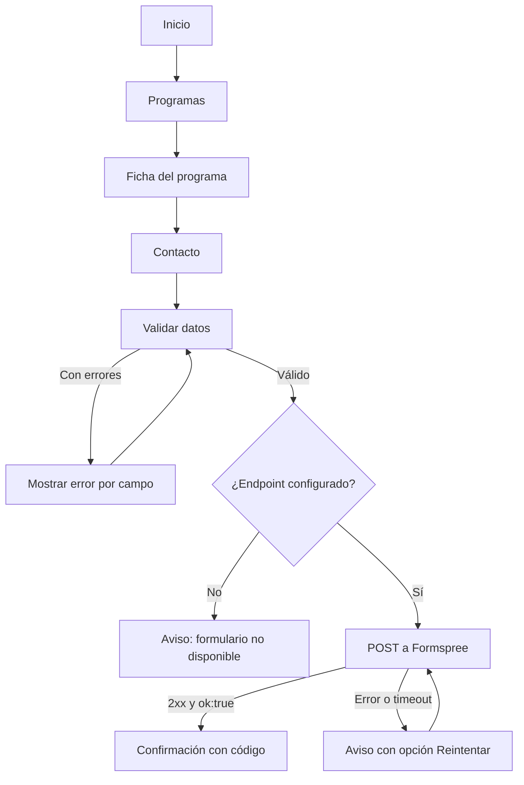
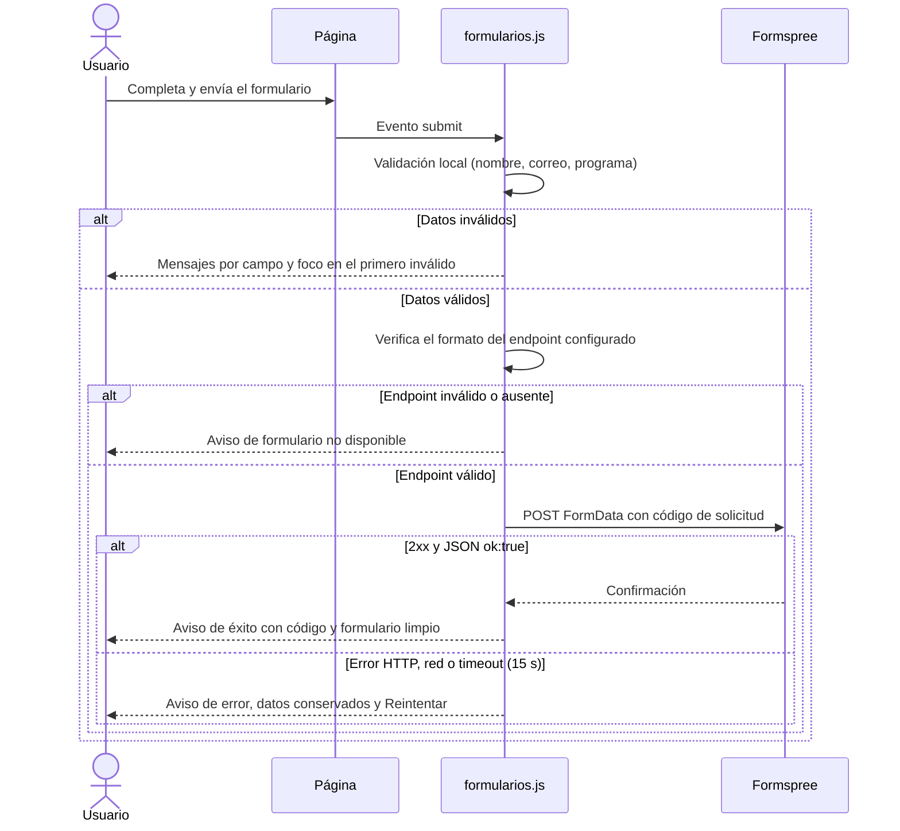
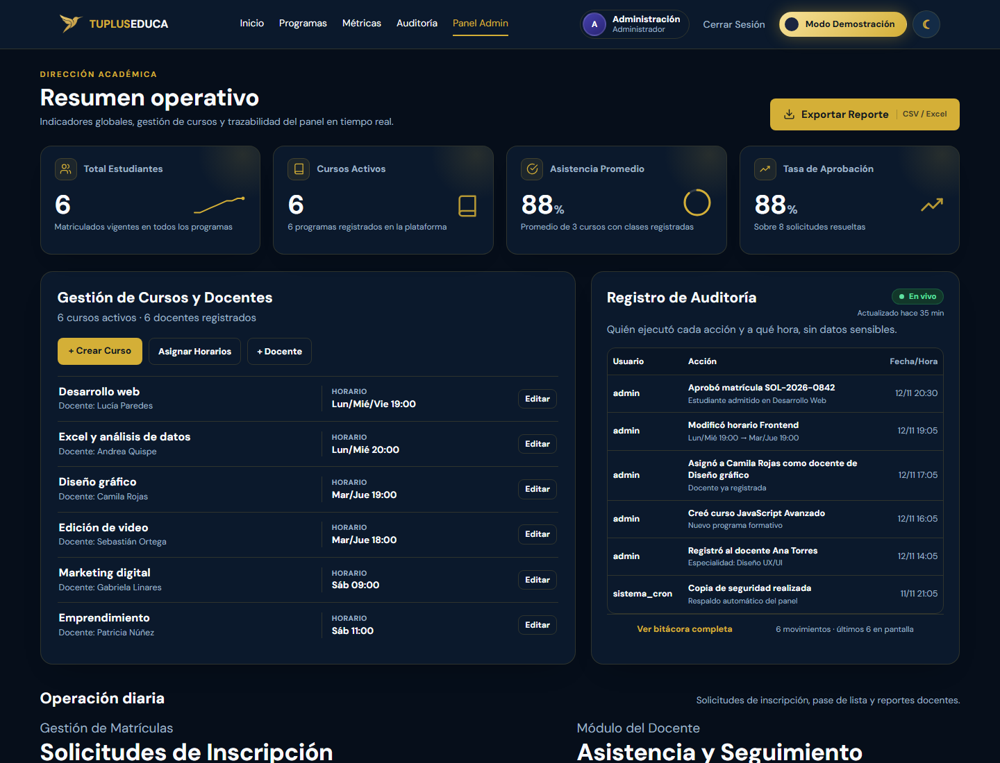

# TUPLUSEDUCA

> **Actualización Nivel 3:** Para usar autenticación por rol, base de datos y portal protegido, ejecuta `npm start` con **Node.js 22.13+** y abre `http://127.0.0.1:5500`. **No uses Live Server ni el hosting estático para las pantallas protegidas.** Se han recuperado las cuentas originales `admin`, `docente` y `alumno` (Ana Gómez) con sus claves anteriores; la única clave nueva que aparece en terminal es la de `alumna2` (Carlos Mendoza).

---

## Documentación anterior — frontend público y Nivel 2

Sitio web estático de captación para programas de formación. Incluye catálogo de programas, ficha de curso, test de afinidad, planificador de estudio, favoritos, buscador interno y un formulario de consulta conectado a Formspree.

El módulo público de formularios no requiere backend propio y se entrega a un servicio externo (Formspree), que reenvía cada solicitud al correo configurado en su panel (por ejemplo, una cuenta de Gmail). No hay credenciales de correo en el código.

## Contenido

- [Stack y estructura](#stack-y-estructura)
- [Diagrama de flujo](#diagrama-de-flujo)
- [Variables de entorno](#variables-de-entorno)
- [Configuración](#configuración)
- [Ejecución local](#ejecución-local)
- [Pruebas](#pruebas)
- [Evidencias](#evidencias)
- [Solución de problemas](#solución-de-problemas)
- [Publicar en GitHub](#publicar-en-github)

## Stack y estructura

- HTML5, CSS3 y JavaScript moderno (vanilla, sin framework en el sitio).
- Datos de programas en `js/datos.js`; estado local con `localStorage` (tema, favoritos, respuestas del test).
- Formulario con validación en cliente y envío `fetch` a Formspree.
- Pruebas de comportamiento con Node.js (`assert` y `vm`), sin red ni credenciales.
- El repositorio incluye Vite para servir el sitio en desarrollo; la web publicada es estática.

```text
TUPLUSEDUCA/
├── index.html
├── 404.html
├── pages/
│   ├── programas.html      Catálogo y filtros
│   ├── curso.html          Ficha del programa
│   ├── test.html           Test de afinidad
│   ├── planificador.html   Cálculo de horas y fechas
│   ├── nosotros.html       Información institucional
│   └── contacto.html       Formulario de consulta
├── css/
│   ├── formularios.css     Avisos de envío y estados del formulario
│   ├── panel.css           Paneles internos
│   ├── dashboard.css       Métricas, cursos y auditoría del administrador
│   └── ...                 Estilos base y por pantalla
├── assets/
├── js/
│   ├── datos.js               Programas, fichas y datos académicos
│   ├── utilidades.js          Helpers, avisos y descargas
│   ├── layout.js              Cabecera, pie y elementos flotantes
│   ├── comun.js               Tema, menú, buscador y boletín
│   ├── formularios-config.js  Endpoints públicos de Formspree
│   ├── formularios.js         Validación, envío y estados del formulario
│   ├── contacto.js            Inicializa el formulario de consulta
│   ├── auditoria.js           Bitácora de acciones del panel
│   ├── gestion-cursos.js      Cursos, docentes y horarios
│   ├── panel-dashboard.js     Indicadores, gestión y exportación
│   └── ...                    Lógica de cada pantalla
├── tests/
│   └── prueba_formularios_n2.cjs
├── docs/evidencias/           Capturas y salida de pruebas
├── .env.example
└── .gitignore
```

## Diagrama de flujo

### Recorrido del usuario



### Envío del formulario



El código de solicitud (`CON-AAAA-...` para consultas) se genera con `crypto.getRandomValues` y se conserva al reintentar mientras los datos no cambien. El motor también sabe emitir `SOL-AAAA-...` para solicitudes de matrícula, aunque esta versión del sitio solo publica el formulario de consulta.

### Datos que recibe Formspree

| Campo | Contenido |
| --- | --- |
| `nombre` | Nombre escrito por la persona |
| `email` | Correo de respuesta |
| `programa` | Nombre legible del programa elegido |
| `programa_id` | Identificador interno del programa |
| `tipo_solicitud` | `consulta_informacion` |
| `codigo_solicitud` | Código único de la solicitud |
| `_subject` | Asunto del correo con el código |

### Estados posibles del envío

| Situación | Mensaje visible | Reintento | Datos del formulario |
| --- | --- | --- | --- |
| Validación local | Error por cada campo | No aplica | Se conservan |
| Endpoint ausente o inválido | Formulario no disponible | No | Se conservan |
| HTTP 401, 403 o 404 | Formulario no disponible temporalmente | No | Se conservan |
| HTTP 429 | Demasiadas solicitudes | Sí | Se conservan |
| HTTP 400 o 422 | El servicio rechazó la solicitud | Sí | Se conservan |
| Otro error HTTP | No se pudo confirmar la recepción | Sí | Se conservan |
| Sin conexión | No hay conexión con el servicio + código | Sí | Se conservan |
| Timeout de 15 s | El envío tardó demasiado + código | Sí | Se conservan |
| Éxito (2xx y `ok:true`) | Confirmación con código | No | Se limpian |

## Panel interno: solicitudes, docentes y alumnos

Además del sitio público hay un panel con inicio de sesión y tres interfaces distintas. Entra por **Ingresar** (cabecera) o en `pages/login.html`.

| Perfil | Pantalla | Qué hace |
| --- | --- | --- |
| Administrador | `pages/panel-admin.html` | Tablero de métricas globales, gestión de cursos, docentes y horarios, bitácora de auditoría, exportación CSV/Excel y tabla de solicitudes de inscripción con botones **Aprobar / Pendiente / Rechazar** |
| Docente | `pages/panel-docente.html` | Elige su curso, ve a sus alumnos matriculados, pasa lista (**Presente / Tarde / Falta**), guarda y envía el reporte |
| Alumno | `pages/panel-alumno.html` | Ve sus cursos, su porcentaje de asistencia por clase y el estado de sus solicitudes |

**Nivel 3:** Las contraseñas se generan aleatoriamente al inicializar SQLite y se almacenan como hash `scrypt` en `server/db.mjs`. No se incluyen en el código ni en un archivo `CREDENCIALES.txt`. El archivo `js/auth.js` ya no valida contraseñas; consulta la sesión concedida por el servidor.

### Tablero del administrador

La pantalla `pages/panel-admin.html` abre con cuatro indicadores calculados en vivo: **Total Estudiantes** (correos únicos con matrícula aprobada), **Cursos Activos**, **Asistencia Promedio** (promedio de los cursos con clases registradas) y **Tasa de Aprobación** (aprobadas sobre solicitudes resueltas).

Debajo hay dos paneles:

- **Gestión de Cursos y Docentes.** Permite crear un programa formativo, editarlo, asignar horarios y registrar docentes sin tocar archivos de código. Los cursos base conservan los identificadores del catálogo (`web`, `diseno`…), así que la asistencia y las matrículas siguen funcionando. Los cursos nuevos quedan disponibles en el panel y en el pase de lista de este navegador.
- **Registro de Auditoría.** Guarda con fecha y hora quién aprobó una matrícula, modificó un horario, creó un curso, registró un docente o exportó un reporte. No incluye correos, contraseñas ni datos íntimos; las entradas de ejemplo se ocultan al desactivar el Modo Demostración.

El botón **Exportar Reporte (CSV/Excel)** genera un archivo con las métricas, los cursos y horarios, la bitácora completa y las solicitudes. El CSV es texto plano; el Excel es un libro `.xls` con una hoja por sección.

Los datos de gestión y auditoría se guardan en `localStorage` (`tp_gestion_v1` y `tp_auditoria_v1`). El catálogo público sigue leyéndose de [`js/datos.js`](js/datos.js): un curso creado solo desde el panel no aparece todavía en el sitio público.

### Cómo fluyen los datos — almacén histórico frontend (no integrado a SQLite)

1. Una persona envía el formulario de **Matrícula** (`pages/matricula.html`) o de **Contacto**.
2. Cuando Formspree confirma la recepción, la solicitud se copia al panel como **Pendiente** (código `SOL-…` o `CON-…`). Si el envío falla, no se registra, igual que el correo.
3. En el **panel demostrativo anterior** el administrador cambia el estado en `localStorage`; ello no modifica SQLite ni el nuevo portal del alumno. La integración con la base compartida está pendiente del equipo.
4. El docente guarda la asistencia del día y puede enviar el reporte, que aparece en el panel del administrador. La asistencia cuenta *presente* y *tarde* como clase asistida.

### Límites que debes conocer

- **Los datos de los paneles antiguos de administrador/docente viven en `localStorage`** y no se sincronizan entre dispositivos. En cambio, el **portal del alumno N3** sí consulta SQLite desde un servidor protegido. Formspree tampoco sincroniza automáticamente sus solicitudes con SQLite.
- **El inicio de sesión N3 se valida en Node**, con cookie HttpOnly y bloqueo HTTP 403 para roles incorrectos. El servidor es obligatorio; no se puede sustituir por un host estático.
- **Los cursos creados en el panel son internos.** Se guardan en este navegador y se usan para horarios, docentes y pase de lista; el catálogo público y los formularios siguen tomando los programas de `js/datos.js`.
- **Modo Demostración** (cabecera del panel): muestra u oculta 12 solicitudes y asistencias de ejemplo. Las solicitudes reales nunca se ocultan ni se borran con él.

### Pruebas del panel

```bash
node tests/prueba_formularios_n2.cjs   # formularios (34 pruebas)
node tests/prueba_panel.cjs            # almacén demostrativo heredado (24 pruebas)
npm run test:n3                   # autenticación real, permisos y privacidad (9 pruebas)
node tests/prueba_dashboard.cjs        # gestión de cursos y auditoría (21 pruebas)
```

Para probar también los ingresos con contraseña real, crea un JSON `{"admin":{"clave":"…"},"docente":{"clave":"…"},"alumno":{"clave":"…"}}` fuera del repositorio y ejecuta `TP_CRED=ruta/al.json node tests/prueba_panel.cjs`.

## Variables de entorno

Este proyecto es estático y **no lee archivos `.env` en tiempo de ejecución**. La configuración efectiva del formulario vive en [`js/formularios-config.js`](js/formularios-config.js). La plantilla [`.env.example`](.env.example) existe como referencia para scripts de despliegue o automatización y no contiene secretos.

| Variable | Ejemplo | Uso |
| --- | --- | --- |
| `SITIO_BASE_URL` | `http://localhost:5500` | URL base para documentación o scripts de despliegue |
| `PUERTO_LOCAL` | `5500` | Puerto del servidor local (coincide con `.vscode/launch.json`) |
| `FORMSPREE_CONTACTO_URL` | `https://formspree.io/f/REEMPLAZAR_ID_CONTACTO` | Endpoint del formulario de consulta |
| `FORMSPREE_MATRICULA_URL` | `https://formspree.io/f/REEMPLAZAR_ID_MATRICULA` | Endpoint reservado para una futura página de matrícula |
| `ENTORNO` | `development` | Etiqueta del entorno de trabajo |

Reglas:

- Nunca subas un `.env` real: ya está excluido en [`.gitignore`](.gitignore).
- No escribas contraseñas, API keys ni tokens privados en estos archivos.
- Los identificadores de formulario de Formspree son públicos por diseño; la protección contra abuso se configura en el panel de Formspree (dominios permitidos, filtros de spam y límites).

## Configuración

### 1. Endpoint del formulario

1. Crea el formulario en [Formspree](https://formspree.io/).
2. Copia la URL, con el formato `https://formspree.io/f/<identificador>`.
3. Edita [`js/formularios-config.js`](js/formularios-config.js):

```js
window.TP_FORMULARIOS_CONFIG = Object.freeze({
  contacto: "https://formspree.io/f/TU_ID_DE_CONTACTO",
  matricula: "https://formspree.io/f/TU_ID_DE_MATRICULA"
});
```

El código solo acepta URLs con ese formato exacto; si falta o es inválida, muestra un aviso y no realiza la petición.

4. En el panel de Formspree, configura el correo de notificación (por ejemplo, tu Gmail), los dominios permitidos y las opciones antispam.

### 2. Datos de contacto visibles

Reemplaza los datos de ejemplo en [`pages/contacto.html`](pages/contacto.html):

- Correo `hola@tupluseduca.com`.
- WhatsApp `+51 999 999 999` (también en [`js/layout.js`](js/layout.js), enlace flotante).
- Horario de atención.

### 3. Fecha de la próxima cohorte

La cuenta regresiva se configura en [`js/inicio.js`](js/inicio.js):

```js
const INICIO = new Date("2026-12-01T09:00:00");
```

### 4. Catálogo y fichas de programas

Los programas, precios, módulos, docentes y reseñas se editan en [`js/datos.js`](js/datos.js). Las imágenes correspondientes están en `assets/`.

## Ejecución local — Nivel 3 protegido

Se requiere **Node.js 22.13 o superior**. Ejecuta el servidor Node, NO Live Server, `http-server`, `vite`, GitHub Pages ni `file://` para los paneles privados.

```bash
npm start
```

Abre `http://127.0.0.1:5500/pages/login.html` y utiliza las claves anteriores para `admin`, `docente` y `alumno`; la clave de `alumna2` aparece una vez en la terminal. `npm run dev` es equivalente a `npm start`. Si olvidaste una clave, usa `npm run clave:demo -- alumno` con el servidor detenido. Consulta [la guía N3](docs/GUIA_NIVEL3.md) y [la recuperación de cuentas](docs/RECUPERACION_CUENTAS_N3.md).

El despliegue público necesita alojamiento de Node.js con HTTPS y control del almacenamiento de SQLite; el producto N3 **no** se debe publicar como un simple conjunto de archivos HTML.

## Pruebas

```bash
node tests/prueba_formularios_n2.cjs
```

La suite valida, sin red ni credenciales reales:

- Estructura de la página de contacto y del formulario.
- Errores obligatorios, correo inválido y foco accesible.
- Ausencia de peticiones cuando el endpoint no está configurado.
- Error HTTP 503, conservación de datos y reintento con el mismo código.
- Éxito únicamente con 2xx y `ok:true`.
- Códigos `CON-` y `SOL-`, consentimiento de matrícula y caída de red.

Salida esperada:

```text
TOTAL 34 pruebas correctas
```

La salida completa está en [`docs/evidencias/pruebas-formularios.txt`](docs/evidencias/pruebas-formularios.txt).

## Evidencias

Las capturas se generaron con Chrome headless contra el servidor local, simulando las respuestas de Formspree mediante `fetch`. **No se enviaron solicitudes reales.**

### Validación

Formulario vacío: se muestran los tres errores y el foco pasa al primer campo inválido.


### Error

Respuesta HTTP 503 simulada: aviso flotante de error, opción **Reintentar** y datos conservados.


### Éxito

Respuesta 2xx con `{ "ok": true }`: confirmación con código de solicitud y formulario limpio.


### Pruebas automatizadas

La salida completa de las 34 pruebas está en [`docs/evidencias/pruebas-formularios.txt`](docs/evidencias/pruebas-formularios.txt).

### Panel de administración

Tablero con métricas globales, gestión de cursos y docentes, bitácora de auditoría y exportación de reportes.



## Solución de problemas

| Síntoma | Causa probable | Acción |
| --- | --- | --- |
| El formulario muestra "no disponible" | Endpoint ausente o con formato distinto a `https://formspree.io/f/<id>` | Revisa `js/formularios-config.js` |
| "No disponible temporalmente" | Formspree devolvió 401, 403 o 404 | Verifica el identificador y los dominios permitidos |
| "Hay demasiadas solicitudes" | Límite de Formspree (HTTP 429) | Espera o revisa el plan de Formspree |
| "El servicio rechazó la solicitud" | Datos rechazados (HTTP 400 o 422) | Revisa los campos y la configuración del formulario |
| "No hay conexión con el servicio" | Red caída o URL inaccesible | Comprueba la conexión y el endpoint |
| "El envío tardó demasiado" | Sin respuesta en 15 s | Usa Reintentar; el código se conserva |
| Los cambios no se ven | Caché del navegador | Recarga con `Ctrl+F5` |
| No llegan los correos | Notificación o spam mal configurados | Revisa el panel de Formspree y la carpeta de spam |

## Publicar en GitHub

El proyecto ya es un repositorio Git. Desde la raíz:

```bash
git add .
git commit -m "Formulario de contacto con envío real, documentación y evidencias"
git push origin HEAD
```

**IMPORTANTE:** GitHub Pages solo podría alojar la parte pública de Nivel 2. **No sirve** para publicar este Nivel 3, porque no ejecuta las comprobaciones de sesión, el 403 ni la base de datos del servidor. Para entregarlo como Nivel 3, usa el servidor Node de esta guía.

El [`.gitignore`](.gitignore) excluye `.env` y archivos temporales; solo se versiona `.env.example`.
